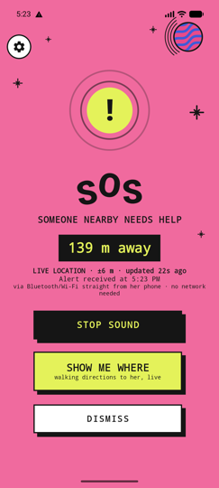
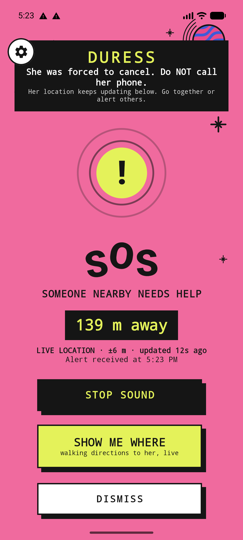
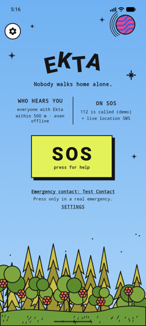
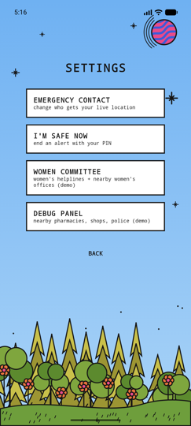
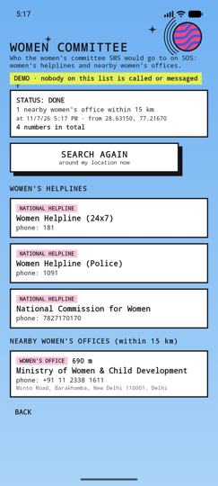
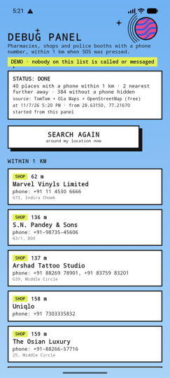
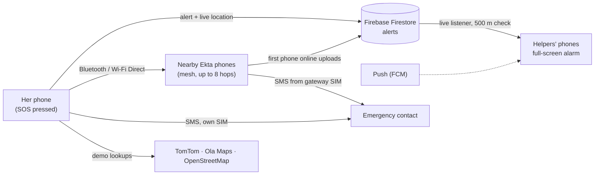

<p align="center">
  
</p>
<h1 align="center">Ekta SOS</h1>
<p align="center"><strong>Nobody walks home alone.</strong></p>
<p align="center">One button alerts every Ekta phone within 500 m, shares her exact live location, and keeps working with no internet or signal.</p>
<p align="center">
  
  
  
  
  
</p>
<p align="center">
  <a href="#what-happens-when-she-presses-sos">What SOS does</a> · <a href="#screens">Screens</a> · <a href="#try-it-in-five-minutes">Try it</a> · <a href="#run-locally">Run locally</a> · <a href="#how-it-works">How it works</a> · <a href="#testing">Testing</a>
</p>

| Her phone | A helper's phone nearby | Forced to cancel (duress) |
| --- | --- | --- |
|  |  |  |

## Why Ekta

When a woman feels unsafe, the people who can help fastest are the ones already **nearby**, not just a contact across the city. But a nearby helper needs to know **that** she needs help, **where she is right now**, and **whether it's safe to call her**.

Ekta turns every phone with the app into a neighbour who can respond. Pressing SOS rings every Ekta phone within 500 m with a full-screen alarm, even on the lock screen, and keeps sending her exact live location as she moves. If there's no internet or signal, the alert hops phone-to-phone over Bluetooth until one phone can get it online. If someone forces her to cancel, a secret **duress PIN** makes her screen look cancelled while help keeps coming.

Built for a hackathon: calling **112** and messaging the **women's committee** are shown as **demos**. Nothing is dialled and no committee is messaged.

## What happens when she presses SOS

| What happens | Real or demo |
| --- | --- |
| Every Ekta phone **within 500 m** gets a **full-screen alert** that rings (even in silent mode) and vibrates | **Real** |
| Her **emergency contact** gets an SMS with a map link and how exact it is ("accurate to 8 m"), then a fresh location **every 2 min** | **Real** (normal SMS) |
| Her **exact live location** keeps updating on helpers' phones as she moves; **SHOW ME WHERE** opens walking directions to her | **Real** |
| **No internet or signal:** the alert travels over **Bluetooth / Wi-Fi Direct**, hop by hop, until a phone with internet uploads it and texts her contact from its own SIM | **Real** |
| **112** is called | **Demo:** an on-screen call card, no call is placed |
| SMS to the **women's committee** (helplines + nearby women's offices) | **Demo:** listed in Settings, never sent |
| Nearby **pharmacies, shops and police booths** with phone numbers are found | **Demo:** listed in the Debug panel, nobody is contacted |

**Cancelling needs a PIN.** Her normal PIN really cancels and tells everyone she's safe. Her **duress PIN** shows the same "Alert cancelled" screen, but the alert keeps running silently and helpers see **"DURESS: she was forced to cancel. Do NOT call her phone."** Later, **"I'm safe now"** (long-press SOS, or Settings) ends it for real.

## Screens

| Home | Settings (⚙ on every page) |
| --- | --- |
|  |  |
| **One button.** The ⚙ in the corner opens Settings from any page, even during an SOS. | **Everything else** lives here, so the main screen stays simple. |

| Women committee (demo) | Nearby places (demo) |
| --- | --- |
|  |  |
| Women's helplines and nearby women's offices the committee SMS would go to. | Pharmacies, shops and police booths **with phone numbers**, nearest first, from free map data. |

Screenshots are from the Android emulator placed at Connaught Place, New Delhi, with test data.

## Try it in five minutes

1. **Install and set up.** Open Ekta and tap **TURN ON SOS ALERTS**. Allow each permission, add an emergency contact, and choose a **cancel PIN** and a **duress PIN**.
2. **Press SOS** on one phone. A second phone nearby shows the full-screen alarm with the distance and her live location. Her contact gets the SMS.
3. **Walk around** with the SOS phone; the helper's distance and map follow her. Tap **SHOW ME WHERE**.
4. **Cancel with the duress PIN.** Her screen says "Alert cancelled"; the helper's phone switches to **DURESS**. Long-press SOS and enter the normal PIN to end it for real.
5. **Go offline.** Put the SOS phone in airplane mode with Bluetooth on, keep the phones within a few metres, and press SOS. The alert still arrives.
6. **Open Settings** (⚙) to see the **Women committee** and **Debug panel** lists.

**Tip:** for practice, set the emergency contact to your own second number. Keep Location (GPS) on and stand near a window for exact positions.

## Run locally

**Requirements:** Android Studio (JDK 17+), the Android SDK, and an Android 8.0+ phone or emulator.

```bash
git clone https://github.com/Snigdha-pal205/ekta.git
cd ekta
./gradlew :app:assembleDebug
adb install -r app/build/outputs/apk/debug/app-debug.apk
```

**Firebase:** put `google-services.json` for an Android app named `com.ekta.sos` in `app/` (not committed; it holds the project's API key). Create a Firestore database and publish the rules with `firebase deploy --only firestore:rules`.

**Optional free map keys** (for the Women committee and Debug panel lists). Add them to `local.properties`, which is never committed:

```properties
TOMTOM_API_KEY=...      # free, no card: 2,500 requests a month (my.tomtom.com)
OLA_MAPS_API_KEY=...    # free: 100,000 calls a month
```

Without them, Ekta still works and uses OpenStreetMap alone. Over a free limit, requests are refused, never charged.

## How it works



| Part | What it does |
| --- | --- |
| `SosSession` | The SOS from press to "I'm safe": keys, live tracking, SMS, cancel and duress. |
| `LiveLocation` | Fresh GPS for the whole SOS (fused + raw GPS chip); sends a new point when she moves. |
| `AlertListenerService` | Always-on listener: alerts from the server, push and mesh; 500 m check; full-screen alarm. |
| `MeshManager`, `Gateway` | Offline Bluetooth / Wi-Fi Direct mesh; the first phone with internet uploads and texts her contact. |
| `AlertActivity`, `AlarmPlayer` | The helper's alert page, live distance, and the looping alarm. |
| `NearbyPlaces`, `TomTomPlaces`, `OlaPlaces`, `OsmPlaces` | Demo lookup of nearby places with phone numbers (Debug panel). |
| `WomenHelp` | Demo women's committee list: helplines and nearby women's offices. |
| `firestore.rules` | Who may cancel, report duress or move a location (checked with secret-key hashes). |

### Rules that keep an SOS trustworthy

- **A cancel can't be faked.** On SOS her phone creates secret keys and sends only their SHA-256 hashes. A cancel, duress or location update must reveal the matching key; helpers' phones and the Firestore rules both check it.
- **Duress stays hidden.** Her phone stays silent and looks normal; only the duress key can mark it duress, and only the cancel key can end it.
- **Newest location wins.** An older position can never replace a newer one, on the server or on helpers' phones.
- **Helpers only act on confirmed changes**, and a cancelled alert is final.
- **Privacy:** listeners never upload their location; only the person who presses SOS shares where she is.

## Testing

| Command | What it checks |
| --- | --- |
| `python3 tests/e2e.py 1` | Full end-to-end round on an emulator: setup, SOS, SMS, live location, PINs and duress, distances, lock screen, offline mesh, gateway, push, restart. |
| `python3 tests/places_test.py` | Nearby places with fake TomTom / Ola / OpenStreetMap servers: requests, list, errors, retries, offline, no calls or messages. |
| `python3 tests/rules_location.py` | Firestore rules for live-location updates. |
| `./test-alert.sh <lat> <lng>` | Sends a fake SOS from that spot; phones within 500 m should ring. |

## Limitations

- Android only; iPhones can't join the Bluetooth mesh. Mesh range is roughly 10–100 m per hop.
- Each phone must open Ekta once and finish setup; after that it keeps listening, even after a restart. On Xiaomi phones, allow pop-up windows, lock-screen display and Autostart (the app walks you through it).
- Indoors, GPS can be tens of metres off; the app says how exact it is and shows **VERY CLOSE** when two rough positions can't give an exact distance.
- Free map data doesn't have every shop or office; the lists show only places that have a phone number.
- There's no sign-in yet, so anyone with the Firebase config can read alerts; add Firebase Auth before a real launch. Revealed duress/location keys could be reused to post fake location points (not to cancel).
- `SEND_SMS` works for direct installs; the Play Store allows it only for certain app types.
- Helpline numbers come from public sources; confirm them (for example on ncw.nic.in) before any real use.
