<p align="center">
  
</p>
<h1 align="center">Ekta SOS</h1>
<p align="center"><strong>Together, no woman stands alone.</strong></p>
<p align="center">One button alerts every Ekta phone within 1 km, shares her exact live location, and keeps working with no internet or signal.</p>
<p align="center">
  
  
  
  
  
</p>
<p align="center">
  <a href="#product-tour">Product tour</a> · <a href="#five-minute-walkthrough">Walkthrough</a> · <a href="#run-locally">Run locally</a> · <a href="#architecture">Architecture</a> · <a href="#testing">Testing</a>
</p>

| Login | Home | SOS running |
| --- | --- | --- |
| 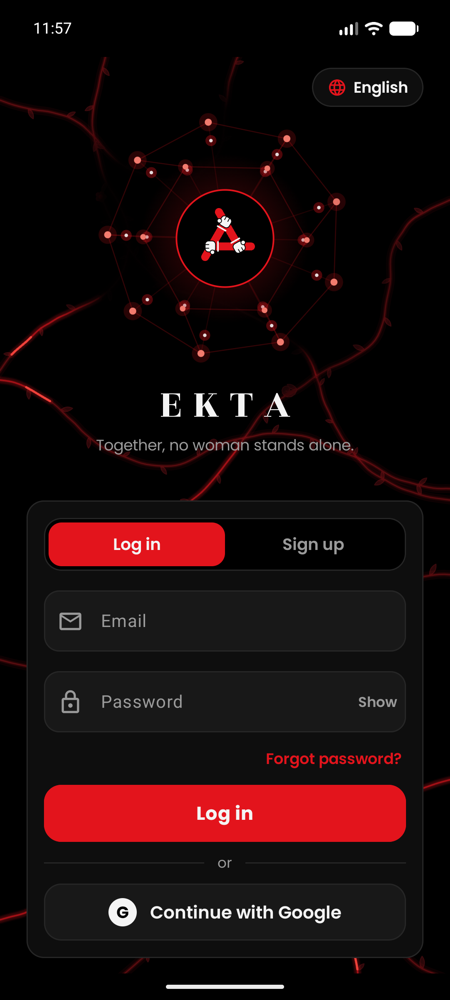 | 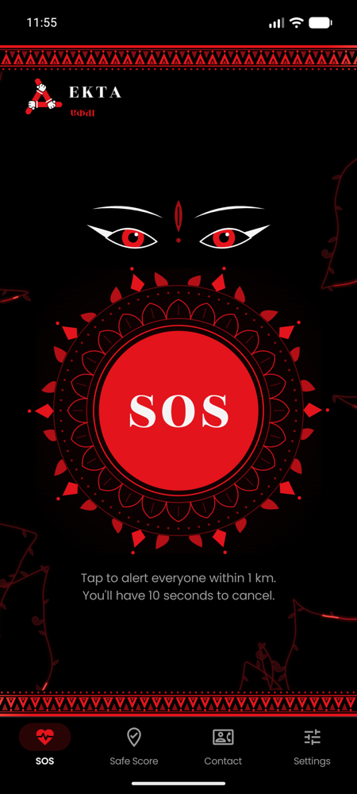 | 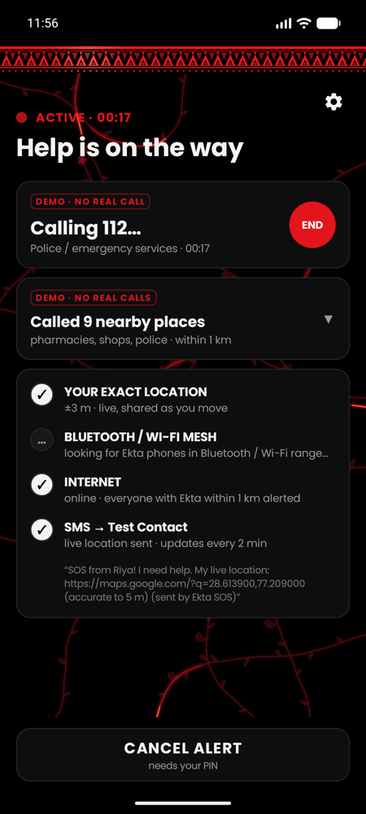 |

## Why Ekta

When a woman feels unsafe, the people who can help fastest are the ones already **nearby**, not just a contact across the city. A nearby helper needs to know **that** she needs help, **where she is right now**, and **whether it's safe to call her**.

Ekta (एकता, "unity") turns every phone with the app into a neighbour who can respond. Pressing SOS rings every Ekta phone within 1 km with a full-screen alarm, even on the lock screen, and keeps sending her exact live location as she moves. If there's no internet or signal, the alert hops phone to phone over Bluetooth until one phone can get it online. If someone forces her to cancel, a secret **duress PIN** makes her screen look cancelled while help keeps coming.

Built for a hackathon. Calling **112** and calling nearby shops are **demos**: nothing is dialled.

## What you can do

| Area | Implemented capabilities |
| --- | --- |
| **Account** | Email and password sign-up and login, Google sign-in, password reset by email, log out from Settings. The app opens only after login. |
| **SOS** | One tap, a 10-second countdown with a single Cancel button, then the alert goes out by itself. |
| **Nearby helpers** | Every Ekta phone within **1 km** gets a full-screen alarm that rings even on silent, with distance, live location and walking directions to her. |
| **Emergency contact** | An SMS with a map link and how exact it is, then a fresh location every 2 minutes, in her chosen language. |
| **Offline mesh** | With no internet or signal, the alert travels over Bluetooth / Wi-Fi Direct (up to 8 hops) until a phone with internet uploads it and texts her contact from its own SIM. |
| **Cancel and duress** | The normal PIN really cancels. The duress PIN shows "Alert cancelled" but keeps the alert running silently; helpers see **"DURESS: do NOT call her phone."** |
| **Nearby places (demo)** | Pharmacies, shops and police booths with phone numbers within 1 km, shown as called with the recorded message: *"A woman near you needs help. Location: [nearest landmark]. Please help her."* |
| **112 (demo)** | An on-screen call card. No call is placed. |
| **Safe Score** | Search a place, pick an hour, get a 0–10 score from five factors, rate the place, share the journey. |
| **Languages** | English, हिन्दी, বাংলা, తెలుగు, मराठी, தமிழ், ગુજરાતી, ಕನ್ನಡ, മലയാളം, ਪੰਜਾਬੀ and ଓଡ଼ିଆ: every screen, alert, notification and SMS. |

## Product tour

### Press, count down, help is on the way

Tap SOS and a 10-second countdown starts. **Cancel** is the only button, so nobody hesitates. If she doesn't cancel, the SOS goes out automatically.

| Countdown | Nearby places (demo) | A helper's phone |
| --- | --- | --- |
| 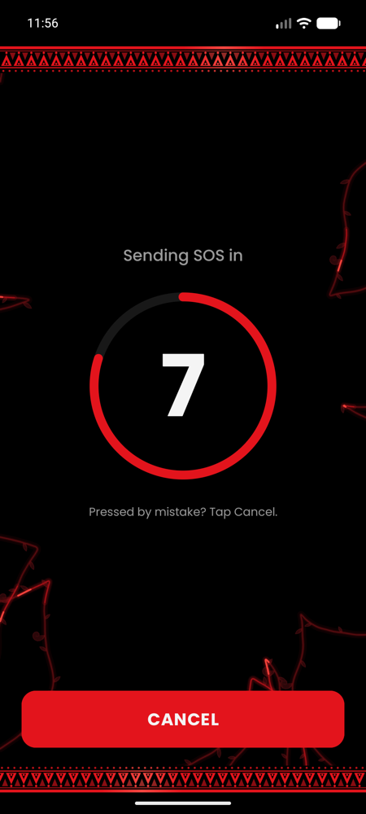 | 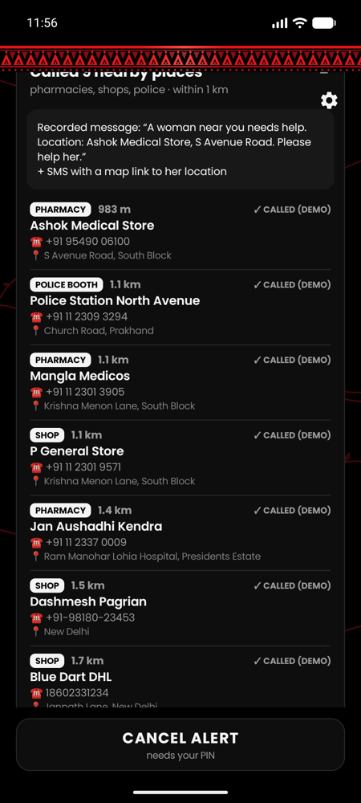 | 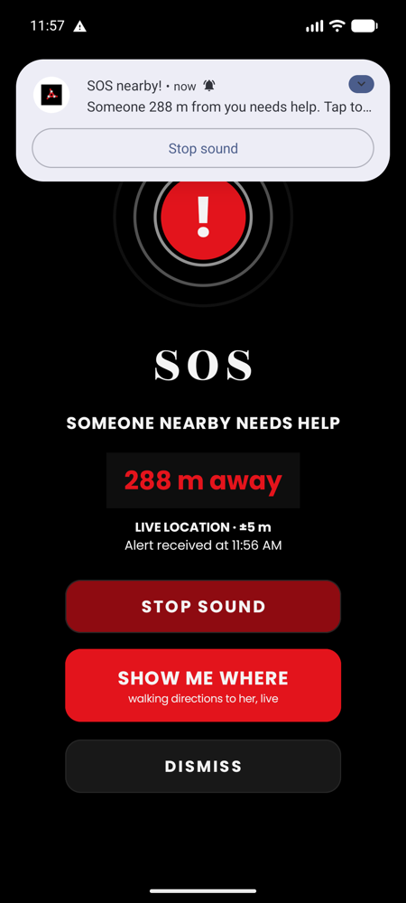 |
| **10 seconds** to cancel, then it sends by itself. | **Who would be called**, nearest first, and what they'd hear. | **Rings even on silent**, with distance and directions. |

### Know your destination

**Safe Score** answers "how safe is this place at the time I'll be there?" Pick a recent place or search one, then choose the hour.

| Safe Score | A place at 11 AM |
| --- | --- |
| 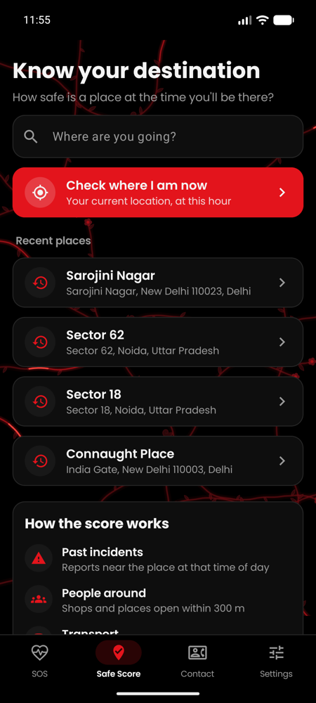 | 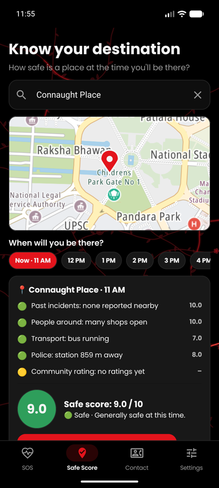 |

<details>
<summary><strong>Contact and Settings</strong></summary>

| Contact | Settings |
| --- | --- |
| 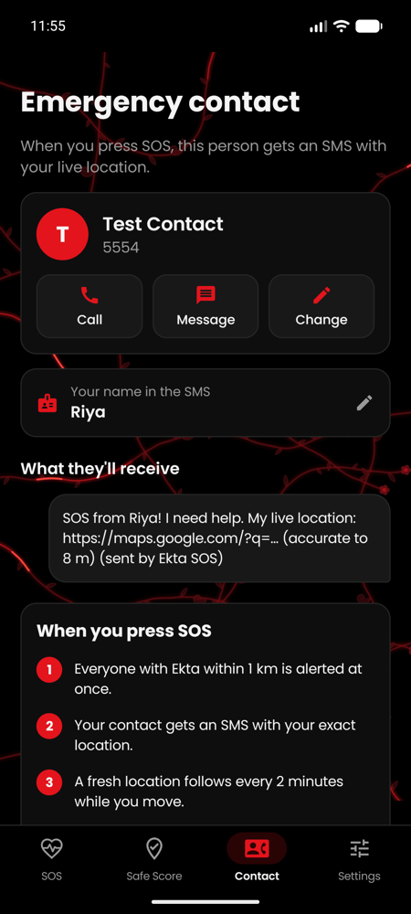 | 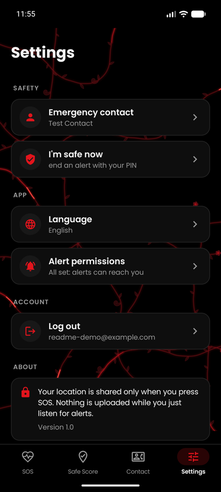 |

</details>

**Interface:** pitch black and red, drawn from the strength of Kali and Durga without religious symbols. The logo is three linked hands, each holding the next woman's wrist (a rescue grip). The SOS button beats like a heart, blood-red light flows through the vines behind every page, and the login page shows a ring of women lit one by one with each heartbeat. Animations run only in the draw phase, so they stay smooth.

Screenshots are from the Android emulator placed at Connaught Place, New Delhi, with a demo account and test data.

## Five-minute walkthrough

1. **Sign up.** Open Ekta, pick your language at the top, then sign up with email or **Continue with Google**.
2. **Turn on alerts.** Tap **TURN ON SOS ALERTS** and allow each permission. Add an emergency contact, a **cancel PIN** and a **duress PIN**.
3. **Press SOS** on one phone and let the 10 seconds run out. A second phone nearby shows the full-screen alarm with the distance and her live location. Her contact gets the SMS.
4. **Walk around** with the SOS phone; the helper's distance and map follow her. Tap **SHOW ME WHERE**.
5. **Open the nearby-places box** under the 112 card to see who would be called and what they'd hear.
6. **Cancel with the duress PIN.** Her screen says "Alert cancelled"; the helper's phone switches to **DURESS**. Long-press SOS and enter the normal PIN to end it for real.
7. **Go offline.** Put the SOS phone in airplane mode with Bluetooth on, keep the phones within a few metres, and press SOS. The alert still arrives.
8. **Check a place** in the **Safe Score** tab at different hours.

**Tip:** for practice, set the emergency contact to your own second number. Keep Location (GPS) on and stand near a window for exact positions.

## Run locally

**Requirements:** Android Studio (JDK 17+), the Android SDK, and an Android 8.0+ phone or emulator.

```bash
git clone https://github.com/Snigdha-pal205/ekta.git
cd ekta
./gradlew :app:assembleDebug
adb install -r app/build/outputs/apk/debug/app-debug.apk
```

### Firebase (free Spark plan)

1. Create a Firebase project and add an Android app named `com.ekta.sos`.
2. **Authentication → Sign-in method:** turn on **Email/Password** and **Google**. Set the public-facing name to *Ekta*.
3. **Project settings → Your apps:** add your debug key's SHA-1 (`keytool -list -v -keystore ~/.android/debug.keystore -alias androiddebugkey -storepass android`). Google sign-in needs it.
4. Download `google-services.json` into `app/`. It is git-ignored; never commit it.
5. Create a Firestore database and publish the rules: `firebase deploy --only firestore:rules`.

Without `google-services.json` the app builds and runs without login or the server; the mesh and SMS still work.

### Free map keys

TomTom is needed for Safe Score; TomTom and Ola Maps both help find nearby places on SOS. Add them to `local.properties`, which is never committed:

```properties
TOMTOM_API_KEY=...      # free, no card: 2,500 requests a month (my.tomtom.com)
OLA_MAPS_API_KEY=...    # free: 100,000 calls a month
```

Without them, SOS still works and nearby places come from OpenStreetMap alone. Over a free limit, requests are refused, never charged.

## Architecture

Ekta is a **single Android app with a serverless backend**. Each phone is both a sender and a listener. Firebase carries alerts when there is internet; a Bluetooth / Wi-Fi Direct mesh carries them when there isn't. There is no custom server: the Firestore security rules are the only server-side logic.

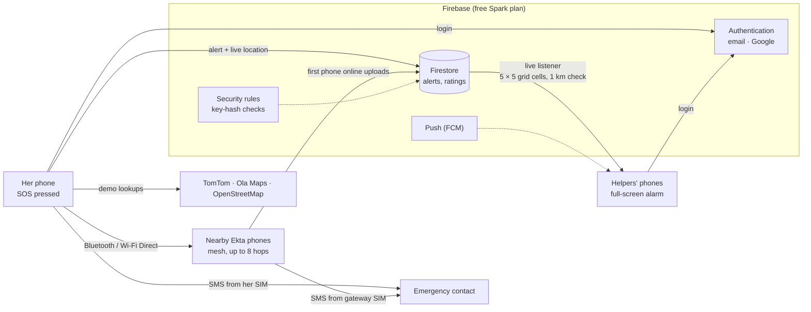

### How an alert finds the right phones

The world is split into a 0.01° grid (about 1.1 km tall and 1 km wide in India). Each alert is tagged with its cell. Each phone listens to its own cell and the two rings around it (5 × 5 = 25 cells, within Firestore's 30-value `in` limit), then measures the exact distance on the phone and rings only within **1 km**. Listeners never upload their own location.

### Code map

| Module | Responsibility |
| --- | --- |
| `MainActivity`, `NavBar` | App shell: login gate, setup, bottom tabs (SOS, Safe Score, Contact, Settings). |
| `Account`, `LoginScreen` | Firebase Auth: email/password, Google via Credential Manager, password reset, log out. |
| `SosScreen`, `SosSession` | The SOS from press to "I'm safe": countdown, keys, live tracking, SMS, cancel and duress. |
| `LiveLocation`, `Geo` | Fresh GPS for the whole SOS; grid cells and the 1 km radius. |
| `AlertListenerService`, `BootReceiver` | Always-on listener (server, push and mesh), distance check, full-screen alarm; restarts after reboot when logged in. |
| `AlertActivity`, `AlarmPlayer` | The helper's alert page, live distance, and the looping alarm. |
| `MeshManager`, `MeshMessage`, `Gateway` | Offline Bluetooth / Wi-Fi Direct mesh; the first phone with internet uploads and texts her contact. |
| `SmsOutbox` | SMS in any of the 11 languages, split safely for Indian scripts. |
| `NearbyPlaces`, `TomTomPlaces`, `OlaPlaces`, `OsmPlaces` | Nearby places with phone numbers when SOS is pressed. |
| `NearbyAlert` | What those places are told. `REAL_MODE = false` (demo). |
| `PinStore`, `PinScreens` | Cancel and duress PINs, the PIN pad, and Settings. |
| `safescore/` | Safe Score: TomTom search and map, five factor files, and `SafeScoreEngine`. |
| `Lang`, `res/values-*` | The 11 languages, switched inside the app. |
| `Theme` | Colours, fonts, the linked-hands mark, vines, heartbeat clock and shared components. |
| `firestore.rules` | Who may create, cancel, report duress or move a location. |

### Rules that keep an SOS trustworthy

- **A cancel can't be faked.** On SOS her phone creates secret keys and sends only their SHA-256 hashes. A cancel, duress or location update must reveal the matching key; helpers' phones and the Firestore rules both check it.
- **Duress stays hidden.** Her phone stays silent and looks normal; only the duress key can mark it duress, and only the cancel key can end it.
- **Newest location wins.** An older position can never replace a newer one, on the server or on helpers' phones.
- **Helpers act only on confirmed changes**, and a cancelled alert is final.
- **Logged out means off.** The app can't be opened to send an SOS, and the always-on listener stays stopped until she logs in again, even after a restart.
- **Privacy:** listeners never upload their location; only the person who presses SOS shares where she is.

### Safe Score

```text
Score = 30% people around + 25% past incidents + 20% transport + 15% police + 10% community
```

A factor with no data is shown as "no data" and left out, never counted as safe. **8+** Safe, **7–7.9** Fairly safe, **5–6.9** Be careful, **below 5** Unsafe. In **Delhi / Noida from 11 PM to 6 AM** the score never goes above **6.5**.

| Factor | How it's worked out |
| --- | --- |
| Past incidents | Reports near the place at that time of day (**sample data** for the demo) |
| People around | Shops and places open within 300 m at that hour |
| Transport | Bus stops, metro and taxi stands within 500 m that run at that hour |
| Police | Distance to the nearest police station |
| Community | Star ratings from other Ekta users for that time of day |

## Testing

| Command | What it checks |
| --- | --- |
| `./gradlew :app:testDebugUnitTest` | Safe Score rules: verdict bands, weights, "no data" left out, late-night Delhi/Noida limit. |
| `python3 tests/e2e.py 1` | End-to-end round on an emulator: setup, SOS, SMS, live location, PINs and duress, distances, lock screen, offline mesh, gateway, push, restart. |
| `python3 tests/safescore_test.py` | Safe Score on the emulator with real map data: places at different hours, labels, late-night limit. |
| `python3 tests/rules_location.py` | Firestore rules for live-location updates. |
| `./test-alert.sh <lat> <lng>` | Sends a fake SOS from that spot; Ekta phones within 1 km should ring. |

The emulator tests were written before the login page; sign in on the emulator once before running them.

## Limitations

- Android only; iPhones can't join the Bluetooth mesh. Mesh range is roughly 10–100 m per hop.
- Each phone must log in and finish setup once; after that it keeps listening, even after a restart. On Xiaomi phones, allow pop-up windows, lock-screen display and Autostart (the app walks you through it).
- Indoors, GPS can be tens of metres off; the app says how exact it is and shows **VERY CLOSE** when two rough positions can't give an exact distance.
- The Firestore rules don't require login yet, so anyone with the Firebase config can read alerts. Revealed duress / location keys could be reused to post fake location points (not to cancel).
- Google sign-in works only for builds signed with a key whose SHA-1 is added in Firebase.
- Free map data doesn't have every shop; the lists show only places that have a phone number.
- `SEND_SMS` works for direct installs; the Play Store allows it only for certain app types.
- Safe Score's past-incident data is **sample data**; real use needs a real incident source.
